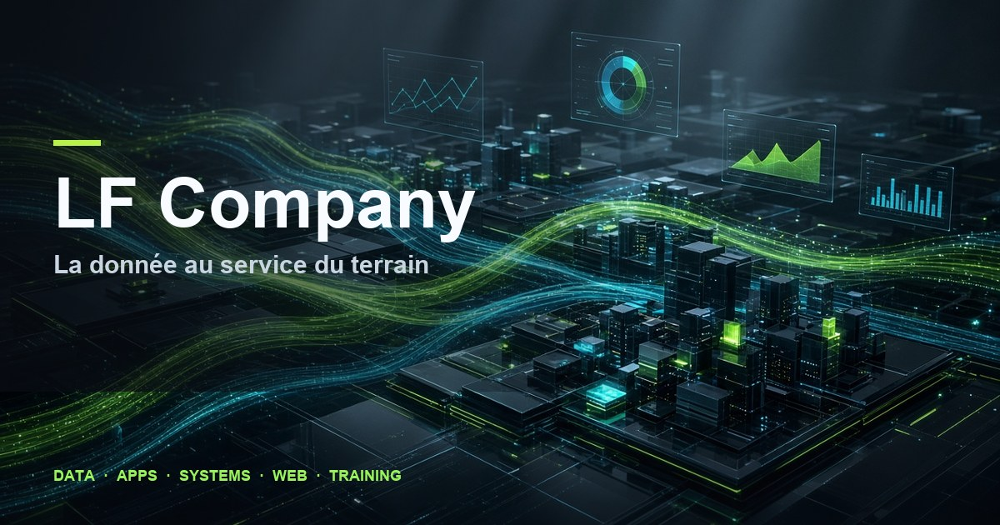
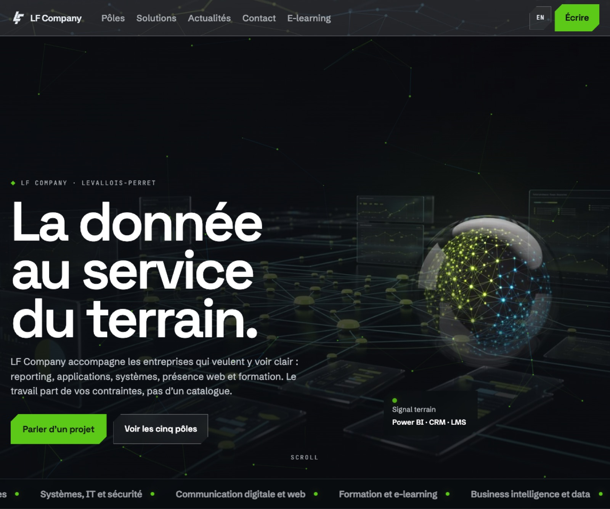
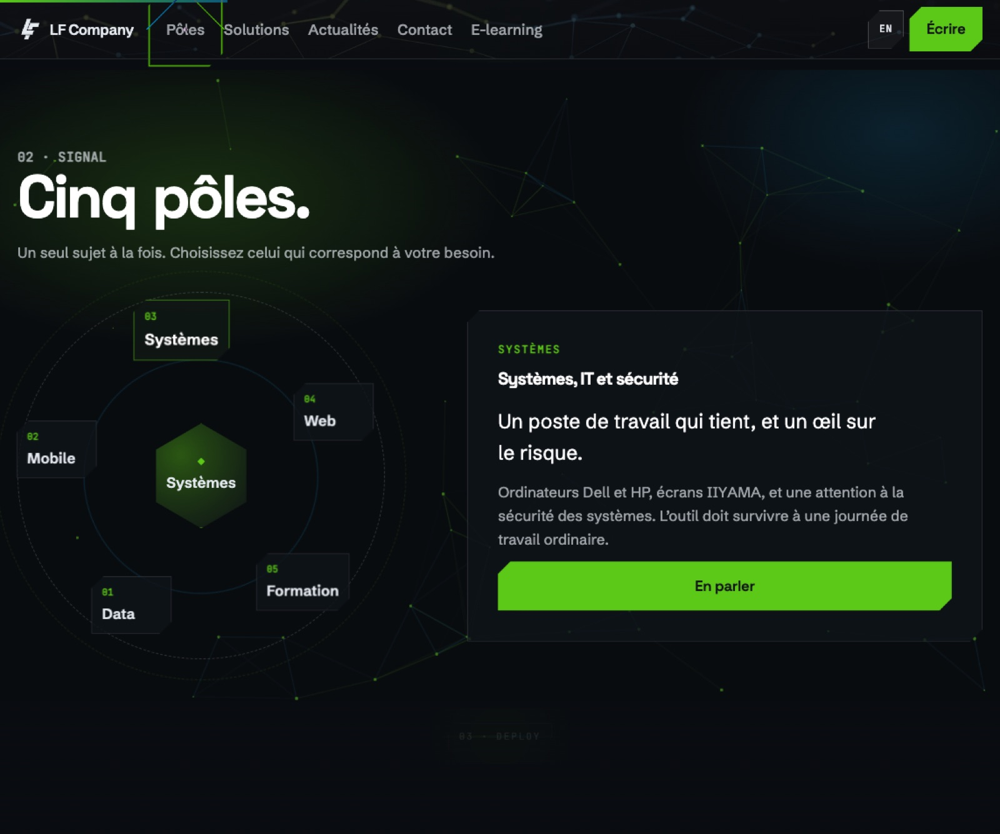
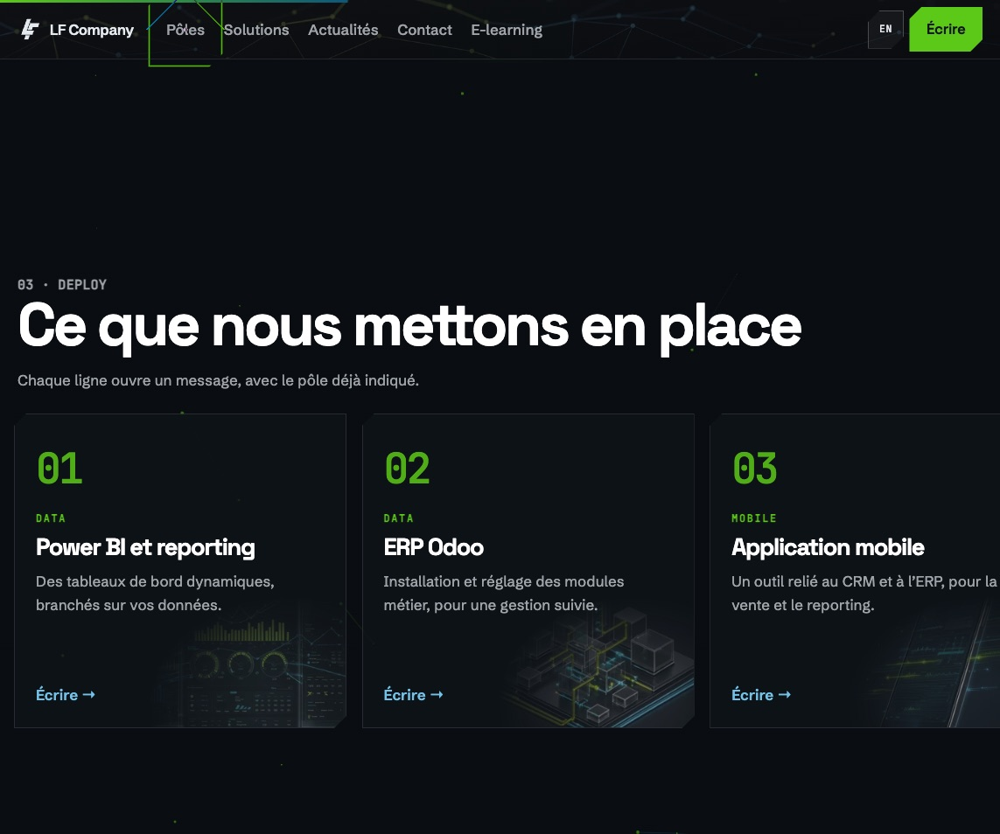
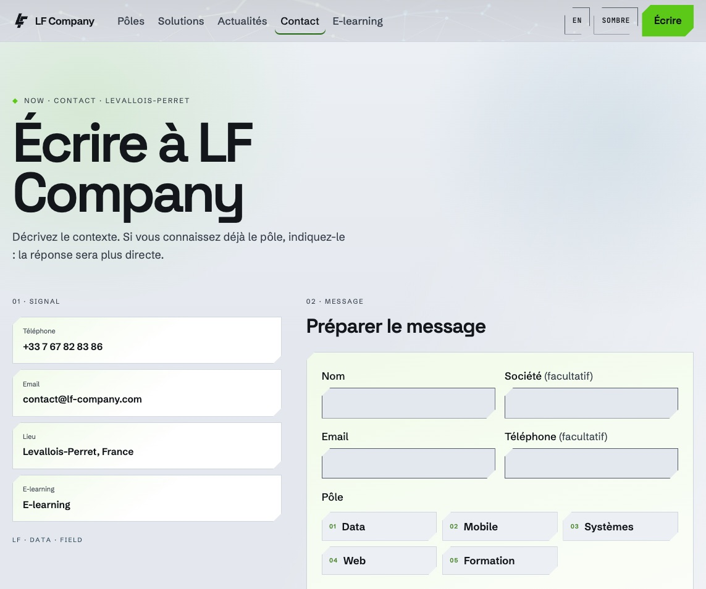

# LF Company

Site vitrine bilingue (FR/EN) pour **LF Company** — data, apps, systèmes, web et formation, depuis Levallois-Perret.

**Live:** [lf-company-five.vercel.app](https://lf-company-five.vercel.app)



## Portfolio

### Hero



### Cinq pôles (orbite interactive)



### Solutions



### Contact (mode clair)



## Stack

- [Astro](https://astro.build) (static) + React islands
- GSAP / Framer Motion
- Three.js (orb hero)
- Design system custom (mesh, cut corners, dark/light)

## Local

```bash
npm install
npm run dev
```

```bash
npm run build
npm run preview
```

## Structure

```
src/
  components/   # React islands + Astro pieces
  layouts/      # Base (OG / i18n)
  pages/        # / et /en + contact
  styles/       # global + awwwards
  assets/       # illustrations 3D
docs/portfolio/ # captures pour showcase
```

## Notes

- i18n FR/EN via `src/i18n/ui.ts`
- Open Graph + Twitter cards (`public/og.jpg`)
- Déployé sur Vercel (`output: static`)
